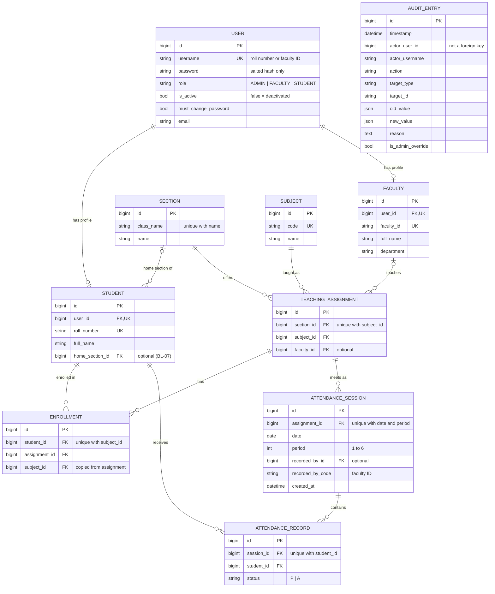

# BL-03 Database Schema

Backlog item: BL-03 (GitHub issue #3) · Sprint 1 · Database: PostgreSQL · Defined as Django models in `apps/*/models.py`, created by the migrations in `apps/*/migrations/`.

## Diagram

`AUDIT_ENTRY` has no links to other tables on purpose, so entries survive when users are deleted.

## Tables

| Table | App | Purpose |
|---|---|---|
| `accounts_user` | accounts | Login account and role. Username is the roll number or faculty ID (BL-01 D-02). |
| `academics_student` | academics | Student profile linked one-to-one to a user, with an optional home class/section (added in BL-07). Subject-by-subject membership is in `academics_enrollment`. |
| `academics_faculty` | academics | Faculty profile linked one-to-one to a user. |
| `academics_subject` | academics | Subject (course) with a unique code. |
| `academics_section` | academics | Class and section, e.g. "B.Tech CSE Year 2" + "A". |
| `academics_teachingassignment` | academics | A subject taught in a section, and the faculty member who teaches it. |
| `academics_enrollment` | academics | A student taking one subject in one section (enrolment is per subject, so electives are supported). |
| `attendance_attendancesession` | attendance | One class meeting. |
| `attendance_attendancerecord` | attendance | One student's status in one session. |
| `audit_auditentry` | audit | Append-only history of attendance and account changes. |

Django also creates its standard tables for permissions, sessions, admin history and migrations.

## Rules enforced by the database

| Rule | How | Source |
|---|---|---|
| Role is Admin, Faculty or Student | Check constraint `user_role_valid` | FR-02 |
| Usernames, roll numbers, faculty IDs and subject codes are unique | Unique constraints | UC-02, UC-03, UC-04 |
| A section name is unique within its class | `section_unique_name` | UC-05 |
| A subject is offered once per section | `assignment_unique_section_subject` | BL-11 |
| A student is in only one section per subject | `enrollment_one_section_per_subject` | BL-01 D-19 |
| Session key: section + subject + date + period | `session_unique_key` (the assignment identifies section + subject) | BL-01 D-08 |
| Period is 1 to 6 | `session_period_range` | BL-01 D-08, team decision (max 6 periods per day) |
| One record per student per session | `record_one_per_student_session` | BL-01 D-08 |
| Status is Present (`P`) or Absent (`A`) only | `record_status_valid` | BL-01 D-06 |
| Audit entries cannot be changed or deleted | PostgreSQL triggers reject UPDATE, DELETE and TRUNCATE | SEC-21, OBJ-04 |

## What happens on deletion

| Deleted | Effect | Source |
|---|---|---|
| Student (via their user account) | Profile, enrolments and that student's attendance records are deleted. Audit entries remain. | BL-01 D-04 |
| Faculty member with teaching assignments | **Blocked** until the assignments are reassigned. | BL-01 D-03, D-04 |
| Faculty member without assignments | Profile and login deleted; sessions they recorded remain and keep their faculty ID. | BL-01 D-04 |
| Subject or section with attendance | **Blocked.** | BL-01 D-05 |
| Subject or section without attendance | Its teaching assignments and enrolments are deleted. | FR-05 |
| Section that is a student's home section | The student's home section is cleared; the student is kept. | BL-07 |
| Audit entry | **Always blocked.** | SEC-21 |

Deactivation (BL-01 D-03) does not delete anything: it sets `is_active` to false on the user.

## Rules checked by the application, not the database

These are enforced in later backlog items because they depend on the current date, settings or the user making the request:

- Session dates cannot be in the future; the correction window (BL-17).
- Every listed student must be marked before saving (BL-12, BL-13).
- Faculty may only mark their assigned classes (BL-05, BL-12).
- Threshold, notification state and correction-window settings are added in BL-22, BL-23 and BL-17.

## Verification

BL-17 adds `attendance_correctionwindow` through migration `0004_correctionwindow`: one row (`id=1`), `days` constrained to 0–30, and `updated_at`. The migration inserts the default of two calendar days. This policy drives both faculty corrections and creation of missed sessions; Admin policy changes and attendance corrections use the existing append-only audit table. Attendance corrections update the existing record rather than creating a second student/session row.

`python manage.py test` runs 37 tests, including one for each rule above. The migrations were also applied to an empty database, and the audit trigger migration was reversed and re-applied successfully.
